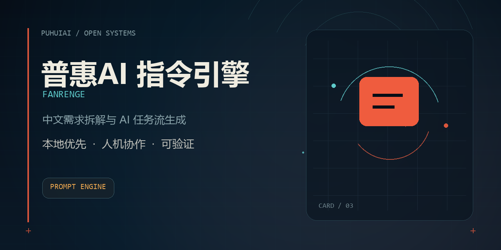

# 普惠AI 指令拆解引擎（凡人歌）：中文 AI 提示词与工作流生成器

普惠AI 指令拆解引擎是一款面向 Windows 和命令行的中文 AI 工具。它把用户的大白话需求拆解为结构化提示词、任务包与可执行工作流，适合提示词工程、Agent 任务设计和 AI 内容生产。

[](https://github.com/puhuiai/puhuiai-fanrenge/releases/latest)


## 下载与使用

- [下载 Windows 4.0.0](https://github.com/puhuiai/puhuiai-fanrenge/releases/download/v4.0.0/Fanrenge_v4.0.0.exe)
- [查看用户手册](docs_用户手册.md)
- [产品中心](https://puhuiai.github.io/website/#fanrenge)

Windows 绿色版下载后直接运行。仓库同时包含 Python 引擎、CLI 和技能包，供有开发能力的用户集成。

## 核心能力

- 将中文自然语言需求拆成清晰任务结构
- 生成可复用的 AI 提示词与任务包
- 内置领域术语、模板与任务流水线
- 支持会话续聊与任务包落盘
- 可作为 Agent Skill 或本地 Python 工具调用

## 适用场景

- AI 提示词工程
- Agent 和工作流设计
- 中文内容生产任务拆解
- 企业内部 AI 操作方法标准化
- 从自然语言需求快速生成执行清单

## 仓库结构

```text
fanrenge/       Python 引擎、CLI 与 Skill
docs_用户手册.md 使用说明
VERSION         当前版本
```

## 授权

本项目为专有软件。个人及企业内部使用规则、转发限制和商业授权说明以 [LICENSE](LICENSE) 为准。

## 反馈

问题与需求请提交 [Issues](https://github.com/puhuiai/puhuiai-fanrenge/issues/new/choose)。

Built by 汪君 · 普惠AI
